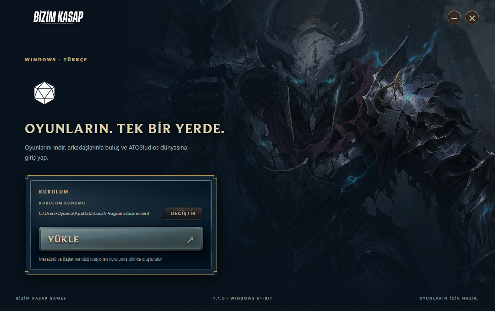

# Bizim Client

Bizim Kasap oyunlarını indir, güncelle ve tek hesapla aç.

**[Bizim Client'i indir](https://github.com/ATOStudios/BizimClient/releases/latest/download/BizimClient-Setup.exe)** · [Son sürüm](https://github.com/ATOStudios/BizimClient/releases/latest)

Windows 10/11, 64 bit. Kurulum internet bağlantısı gerektirir.

Kurulum dosyası gerekli uygulamaları GitHub üzerinden indirir, dosyaları doğrular ve masaüstü / Başlat menüsü kısayollarını oluşturur. Yarım kalan indirmeler tekrar çalıştırıldığında devam edebilir.

Kurulumlar şu anda yayıncı sertifikasıyla imzalı değildir; Windows yayıncıyı doğrulayamayabilir.

1. Kurulumu açıp **YÜKLE** düğmesine bas.
2. Kurulum sonunda **BAŞLAT** ile Bizim Client'i aç.
3. Discord hesabınla giriş yap. Mevcut hesap erişimi için Kasap Discord topluluğu üyeliği gerekir.
4. Oyunlar bölümünden Legends of Aetheria veya Universe of DnD 2'yi kur.

[Legends of Aetheria](https://github.com/ATOStudios/loa) · [Universe of DnD 2](https://github.com/ATOStudios/uod2)
